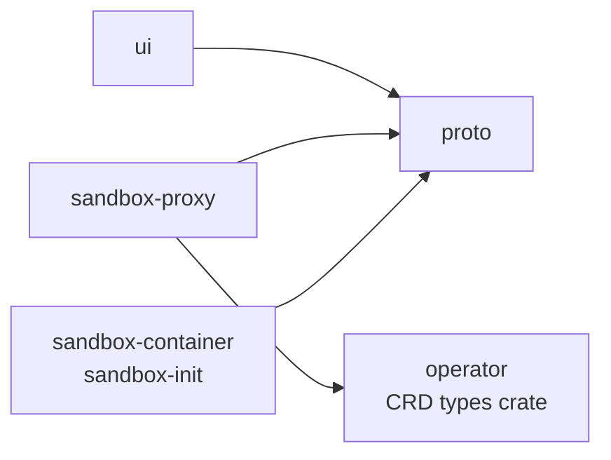

# enzarb architecture

enzarb runs AI coding agents in isolated Kubernetes sandboxes against code repositories. People work in the sandboxes through the web UI (terminals and a chat with the agent). Webhook deliveries from GitHub are logged per repository and shown live in the project's Events tab. Nothing acts on those events yet; workflows and tasks were removed to be redesigned ([ADR-0027](adr/0027-workflow-clean-slate.md)).

**Scope.** Sandboxes against repos, and logging the events those repos send. Deploying user environments is out of scope (see [ADR-0006](adr/0006-scope-no-environments.md)).

## Repositories

All components live in one monorepo, github.com/enzarb/enzarb ([ADR-0015](adr/0015-monorepo.md)), one top-level directory each. Each directory has its own build, checks, Dockerfile and release (tags `<dir>/vX.Y.Z`); the root holds docs, ADRs and the `mise` tasks.

| Dir | Role | Language / artifact |
|---|---|---|
| `ui/` | SvelteKit web app; remote functions are the logic layer. Login, Project management, terminal and chat tabs, per-project Events tab | TypeScript, container image |
| `sandbox-proxy/` | Takes the browser's single websocket, checks authorization, routes mux frames to the right sandbox's pid-1 | Rust, container image |
| `sandbox-container/` | Sandbox image plus pid-1 `sandbox-init`: supervises terminals, chats, git worktrees and dockerd; captures the Claude token | Rust + Dockerfile |
| `operator/` | Reconciles `Project` (`enzarb.dev/v1alpha1`) into an agent-sandbox `Sandbox`, its auth Secret, volumes and NetworkPolicy in the shared sandbox namespace (ADR-0013); publishes the CRD types as a library crate | Rust (kube-rs), container image |
| `proto/` | Mux protocol: frame codec, credit-based flow control, `docs/protocol.md`, shared test vectors | Rust crate + npm package |
| `connectors/` | The `receiver` binary: verifies GitHub webhooks and logs each delivery in `connectors.events` | Rust, container image |
| `ez/` | enzarb's coding agent (ADR-0028): one configuration of modes (system prompt, tools, mise tasks, hooks, model) for every backend; a `claude-code` driver (Claude Code through `claude-agent-acp`, with the setup-token) and a `native` driver (Anthropic API key or OpenAI-compatible endpoints). Speaks ACP; planned to run in the sandbox image | Rust (binary `ez`) |
| `updater/` | Tiny stateless service: polls the chart registry and patches `spec.version` of the RKE2 `HelmChart` to the highest published version (never downgrades; optional release webhook) | Rust, container image |
| `realtime/` | Stateless change stream: `LISTEN connector_event`, pushes `event` / `resync` frames to browsers over an authenticated websocket (`/live/v1/stream`), filtered by repository; the UI refetches via remote functions | Rust, container image |
| `kubernetes/` | Cluster prerequisites: kind config, Envoy Gateway, agent-sandbox (v0.5.x), RuntimeClasses, pgop (Capsule is installed but unused since ADR-0013) | YAML / kustomize |
| `helm/` | Umbrella chart: all services, CRDs, HTTPRoutes, RBAC, pgop `Cluster`/`Role`/`Database`, migration Jobs | Helm |

### Library dependencies between components



Dependencies are path dependencies inside the monorepo (Cargo `path = "../proto/..."`, pnpm `link:../proto`).

`proto/` is its own component because three programs speak it: the browser, the proxy and sandbox-init. It also defines generic step, session and run frames that no orchestrator drives at the moment. See [ADR-0003](adr/0003-mux-protocol.md).

### Self-update chain

component release (`<dir>/vX.Y.Z` tag) → the in-repo chart sync bumps the image tags in `helm/` → `helm/vX.Y.Z` release → chart published to `oci://ghcr.io/enzarb/charts/enzarb` → `enzarb-updater` polls the registry's tag list (every `ENZARB_UPDATER_POLL_SECS`, default 300), picks the highest plain semver and patches `HelmChart.spec.version` (never downgrades) → the RKE2 helm-controller upgrades the release. Nobody runs a deploy task. The updater needs no inbound traffic and no webhook secret; a GitHub release webhook (`/updater/hook`) remains available but is off by default.

The `HelmChart` CR is cluster-owned: it is created once by the cluster bootstrap (`mise run oldie:bootstrap-helmchart`, [oldie.md](oldie.md#upgrading)), never by the chart or the updater, and the updater has no `create` permission. The private chart is pulled with `spec.dockerRegistrySecret`; the updater reads tags with a `read:packages` token from a Secret. `enzarb-updater` lives in the umbrella chart, so it patches the CR before the upgrade restarts it. Monitoring a failed upgrade (rollback, alerting) and upgrading CRDs are deferred. See the [updater README](https://github.com/enzarb/enzarb/tree/main/updater) for env vars and RBAC.

## Runtime view

```mermaid
flowchart LR
  B[Browser<br/>enzarb-ui client] -- HTTPS --> GW[Envoy Gateway<br/>enzarb.local]
  B -- one websocket, enzarb-proto --> GW
  GW --> UI[enzarb-ui]
  GW --> PX[sandbox-proxy]
  SRC[GitHub] -- webhooks --> GW --> RCV[connectors receiver]

  subgraph DB[pgop Cluster enzarb-pg]
    PG[(database enzarb<br/>schemas: connectors, app, app_api)]
  end

  RCV -- INSERT event + NOTIFY connector_event --> PG
  PG -- NOTIFY connector_event --> RT[enzarb-realtime]
  RT -- event frames --> B
  UI -- read connectors.event_v, app --> PG

  UI -- Project CRs --> API[kube-apiserver]
  OP[sandbox-operator] -- watch / reconcile --> API
  API --> AS[agent-sandbox controller] --> SB
  PX --> SB

  subgraph T[Shared namespace enzarb-sandboxes, one sandbox per Project, no Kubernetes API access]
    SB[Sandbox pod: one container<br/>sandbox-init pid-1 as root supervises dockerd<br/>agents and git run as uid 1000<br/>git worktrees, claude (ACP)<br/>gVisor/Kata in prod]
  end
  SB -- git --> SRC
  SB -- Claude API --> AN[Anthropic]
```

## Key flows

### 1. Create a Project
1. In the UI, the user creates a Project: linked repo remotes and sandbox template.
2. A remote function writes the `Project` CR.
3. The operator creates the project's auth Secret, volumes, NetworkPolicy and `Sandbox` CR in the shared sandbox namespace ([ADR-0013](adr/0013-shared-sandbox-namespace.md)).
4. The UI shows a **step-by-step boot checklist** built from the Project/Sandbox status conditions. Every step is a named condition; there are no open-ended spinners.

### 2. Interactive terminal
1. The browser opens one websocket to `sandbox-proxy` with a session token issued by the UI.
2. The proxy checks the token, resolves the Project's sandbox, and dials sandbox-init.
3. Frames are multiplexed: terminals, chats, status events, file transfer. Each is a channel with credit-based flow control.

**Chat.** The Chat page uses the same socket with an `acp` channel ([ADR-0014](adr/0014-chat-tab-acp-over-mux.md), [design](design/chat-tab.md)): sandbox-init runs one `ez acp` per chat ([ADR-0028](adr/0028-ez-coding-agent.md); ez's modes from the repository's `.ez/modes.toml`, on Claude Code through ez's claude-code driver; `ENZARB_CHAT_AGENT=claude` runs `claude-agent-acp` instead) in its own worktree and relays ACP JSON-RPC through a filter; sandbox-init allows permission requests itself (only leaving plan mode is asked of the user): the sandbox (gVisor, network policy, no Kubernetes API, scoped tokens) is the security boundary, not a command allow-list.

### 3. Claude credentials
The user runs a guided `claude setup-token` in the terminal of any of their sandboxes, and pid-1 captures the `sk-ant-oat01-` token. The token is per user, not per Project: pid-1 hands it to the proxy over the mux connection, and the proxy stores it encrypted in Postgres (one row per user, key from a Secret mounted only into the proxy). The proxy hands the token to the sandbox when a chat opens; the sandbox keeps no copy on disk. The token never reaches the browser or the UI. Third-party OAuth against Claude subscriptions is not allowed by Anthropic's terms ([ADR-0004](adr/0004-claude-credentials.md)).

### 4. Webhook events
1. GitHub → `connectors receiver` (`POST /hooks/github`): it checks `X-Hub-Signature-256`, inserts one row into `connectors.events` (a redelivery is a no-op), runs `pg_notify('connector_event', id)` and returns 200.
2. `enzarb-realtime` receives the notification, looks up the event's repository in `connectors.event_v` and pushes `{"topic":"event","id":N,"repo":"owner/repo"}` to the browsers whose `repos` claim contains it.
3. The project's Events tab lists the events of the project's repositories, newest first, and refetches on a frame.

Nothing else happens to an event: no routing, no workflow, no comments.

## Further reading
- [connectors.md](connectors.md): the webhook receiver and the event log
- [database.md](database.md): shared Postgres, schemas and roles via pgop
- [gaps.md](gaps.md): open questions and known gaps
- [adr/](adr/): architecture decision records
