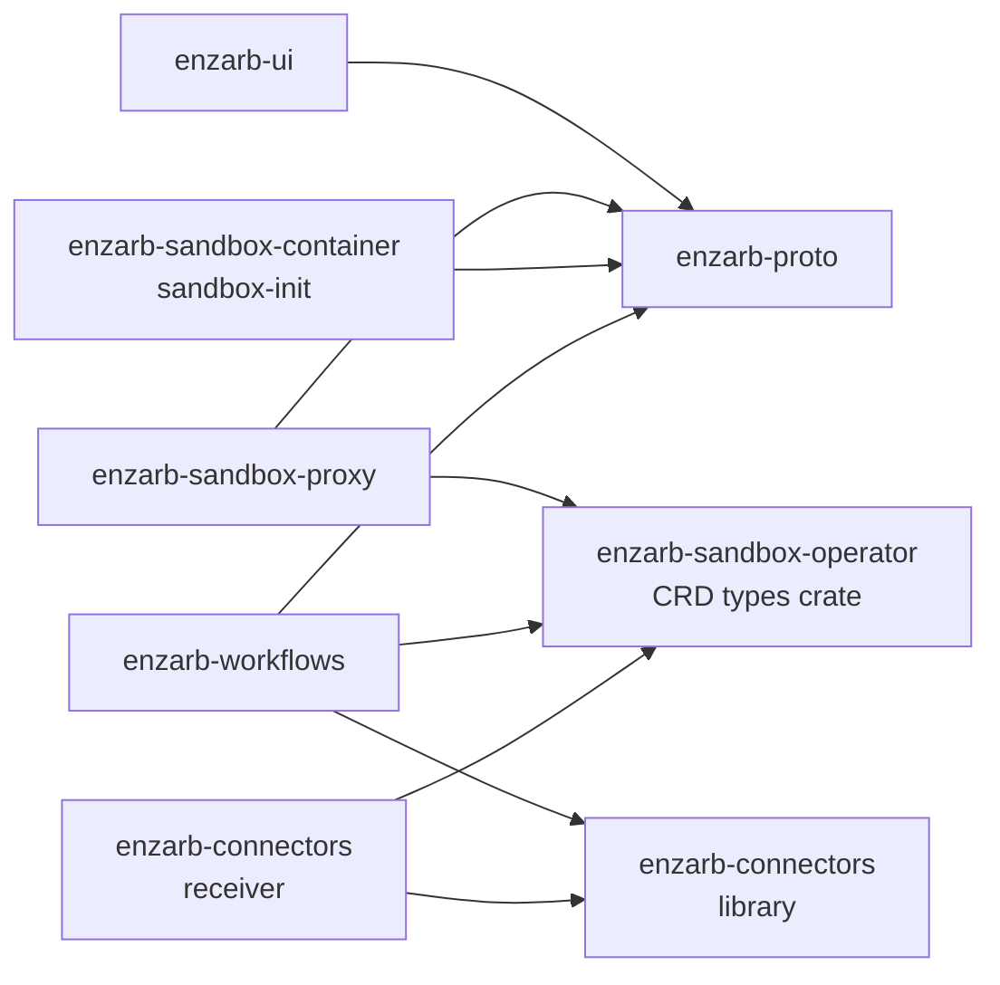
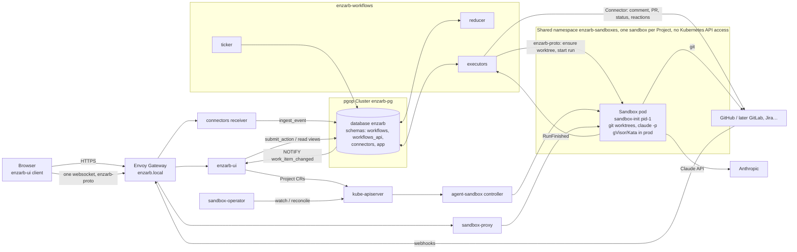

# enzarb architecture

enzarb runs AI coding agents in isolated Kubernetes sandboxes against code repositories. Work starts in two ways: a person in the web UI, or an event from a remote system such as a GitHub issue, PR or comment. Events drive durable workflows (triage → plan → approve → implement → review), and each agent step runs inside a sandbox.

**Scope.** Sandboxes, receiving events, and running workflows in sandboxes against repos. Deploying user environments is out of scope (see [ADR-0006](adr/0006-scope-no-environments.md)).

## Repositories

Each component is its own repository. The top-level `enzarb` repo holds docs, ADRs, the repo manifest (`repos.toml`) and the cross-repo `mise` tasks.

| Repo | Role | Language / artifact |
|---|---|---|
| `enzarb-ui` | SvelteKit web app; remote functions are the logic layer. Login, Project management, workflow/run views, terminal client | TypeScript, container image |
| `enzarb-sandbox-proxy` | Takes the browser's single websocket, checks authorization, routes mux frames to the right sandbox's pid-1 | Rust, container image |
| `enzarb-sandbox-container` | Sandbox image plus pid-1 `sandbox-init`: supervises terminals, git worktrees and headless `claude -p` runs; captures the Claude token | Rust + Dockerfile |
| `enzarb-sandbox-operator` | Reconciles `Project` (`enzarb.dev/v1alpha1`) into an agent-sandbox `Sandbox`, its auth Secret, volumes and NetworkPolicy in the shared sandbox namespace (ADR-0013); publishes the CRD types as a library crate | Rust (kube-rs), container image |
| `enzarb-proto` *(new)* | Mux protocol: frame codec, credit-based flow control, `docs/protocol.md`, shared test vectors | Rust crate + npm package |
| `enzarb-connectors` *(new)* | The `Connector` trait and one connector per source (GitHub first) as a library, plus the `receiver` binary that accepts webhooks | Rust library + container image |
| `enzarb-workflows` *(new)* | The in-house Postgres workflow engine: migrations, state machines, reducer, executors, ticker | Rust, container image |
| `enzarb-updater` *(new)* | Tiny stateless service: on a published `enzarb-helm` GitHub release it patches `spec.version` of the RKE2 `HelmChart` (never downgrades) | Rust, container image |
| `enzarb-realtime` *(new)* | Stateless change stream: `LISTEN work_item_changed`, pushes per-project `work_item` / `resync` frames to browsers over an authenticated websocket (`/live/v1/stream`); the UI refetches via remote functions | Rust, container image |
| `enzarb-kubernetes` | Cluster prerequisites: kind config, Envoy Gateway, agent-sandbox (v0.5.x), RuntimeClasses, pgop (Capsule is installed but unused since ADR-0013) | YAML / kustomize |
| `enzarb-helm` | Umbrella chart: all services, CRDs, HTTPRoutes, RBAC, pgop `Cluster`/`Role`/`Database`, migration Jobs | Helm |

### Library dependencies between repos

`enzarb-proto` lives in its own repo because four programs speak it: the browser, the proxy, sandbox-init, and the workflow executor. The executor is a non-browser client that starts agent runs. See [ADR-0003](adr/0003-mux-protocol.md).

### Self-update chain

component release → `enzarb-helm` sync bumps the image tags → chart published to `oci://ghcr.io/enzarb/charts/enzarb`, **then** the GitHub release is published → release webhook → `enzarb-updater` verifies the chart exists in the registry and patches `HelmChart.spec.version` → the RKE2 helm-controller upgrades the release.

`enzarb-updater` lives in the umbrella chart, so it patches the CR before the upgrade restarts it. Monitoring a failed upgrade (rollback, alerting) is deferred. See the [enzarb-updater README](https://github.com/enzarb/enzarb-updater) for env vars, RBAC and the ordering requirement.

## Runtime view

## Key flows

### 1. Create a Project
1. In the UI, the user creates a Project: linked repo remotes, sandbox template, and run mode (`worktree` or `fresh`).
2. A remote function writes the `Project` CR.
3. The operator creates the project's auth Secret, volumes, NetworkPolicy and `Sandbox` CR in the shared sandbox namespace ([ADR-0013](adr/0013-shared-sandbox-namespace.md)).
4. The UI shows a **step-by-step boot checklist** built from the Project/Sandbox status conditions. Every step is a named condition; there are no open-ended spinners.

### 2. Interactive terminal
1. The browser opens one websocket to `sandbox-proxy` with a session token issued by the UI.
2. The proxy checks the token, resolves the Project's sandbox, and dials sandbox-init.
3. Frames are multiplexed: terminals, the `claude` session, status events, file transfer. Each is a channel with credit-based flow control.

### 3. Claude credentials
The user runs a guided `claude setup-token` in the sandbox terminal, and pid-1 captures the `sk-ant-oat01-` token. Third-party OAuth against Claude subscriptions is not allowed by Anthropic's terms ([ADR-0004](adr/0004-claude-credentials.md)).

### 4. Event-driven workflow (e.g. a new GitHub issue)
1. GitHub → `connectors receiver`: it checks the signature, normalizes the payload, calls `workflows_api.ingest_event`, and returns 200 within 10s.
2. The reducer applies the `issue` state machine. It queues a high-priority `set_progress(Received)` job (👀) and a `triage` agent job.
3. An executor starts the triage run in the Project's sandbox, in a new worktree or a fresh sandbox, over enzarb-proto. sandbox-init reports `RunFinished`, which becomes an event.
4. The workflow continues: questions → plan → `/approve` → implement → PR → review loop. Details in [workflows.md](workflows.md).

## Further reading
- [workflows.md](workflows.md): the workflow engine
- [connectors.md](connectors.md): connector contract and normalized events
- [database.md](database.md): shared Postgres, schemas and roles via pgop
- [gaps.md](gaps.md): open questions and known gaps
- [adr/](adr/): architecture decision records
