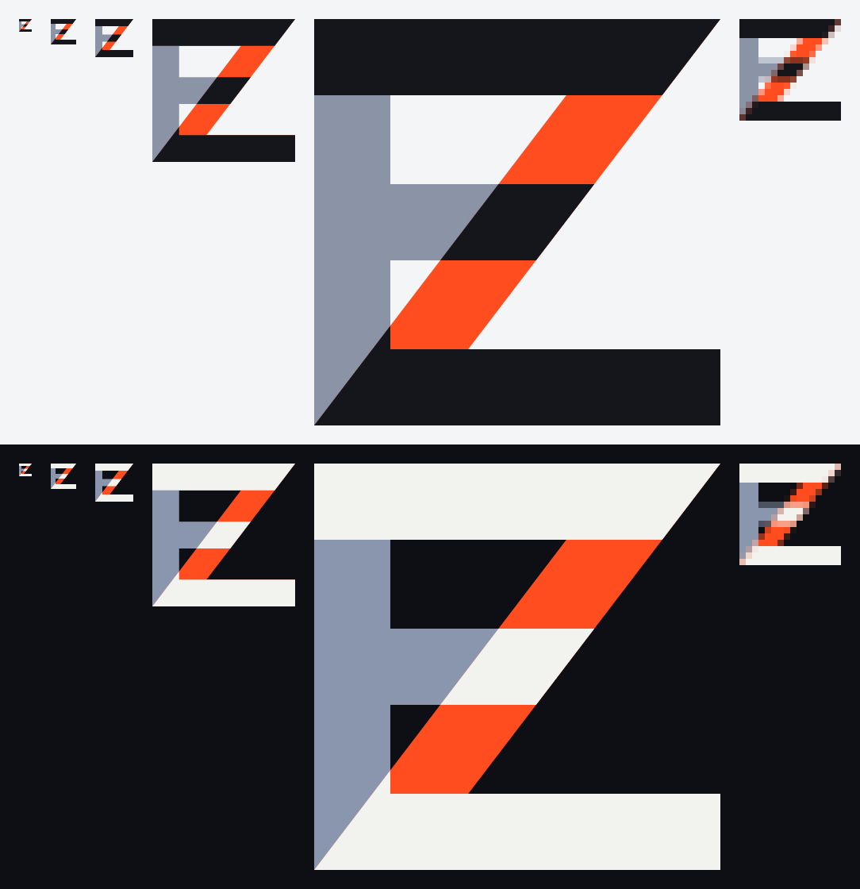

# enzarb brand

Identity for the UI, docs and release material. Assets live in `ui/static/brand/`; the theme tokens are in `ui/src/lib/styles/global.scss`.

## Tone

The Architect: a high-performance specialist. Precise, utilitarian, low-friction.

- No marketing fluff. Short, concrete sentences.
- System-oriented: say what is correct, deterministic and resilient, and what is not.
- Developer-native: CLI- and API-first. Show the command or the field name.

## Palette

"Steel": steel-grey neutrals and one signal orange. Light and dark themes share token names in `ui/src/lib/styles/global.scss`.

| Role                | Light     | Dark      | Token                                        |
| ------------------- | --------- | --------- | -------------------------------------------- |
| Background          | `#F4F5F7` | `#0D0F14` | `--ez-bg`                                    |
| Surface             | `#FFFFFF` | `#151922` | `--ez-surface`                               |
| Sunken              | `#ECEEF2` | `#1D222D` | `--ez-surface-sunken`                        |
| Line                | `#D9DDE4` | `#262C38` | `--ez-border`                                |
| Text                | `#14161B` | `#E9ECF1` | `--ez-text` (links: text colour, underlined) |
| Muted               | `#5F6878` | `#8A96AD` | `--ez-text-muted`                            |
| Signal orange       | `#FF4D1F` | `#FF4D1F` | `--ez-accent` (primary button, focus ring)   |
| Text on orange      | `#14161B` | `#0D0F14` | `--ez-accent-fg`                             |
| Running             | `#C93B10` | `#FF6A3D` | `--ez-info-fg`                               |
| Error / danger      | `#D1242F` | `#FF6369` | `--ez-danger-fg`                             |
| Passed              | `#187A4C` | `#3CCF91` | `--ez-success-fg`                            |
| Needs you / warning | `#946600` | `#F2C14E` | `--ez-warning-fg`                            |

Light running, passed and warning are a shade darker than the issue's `#D43F12`, `#1D8A55` and `#9A6A00`, which fall just under 4.5:1 on their tints (or, for passed, on white).

### Contrast

Every token pair is checked against WCAG 2.x AA by `ui/src/lib/styles/contrast.spec.ts`, which parses `global.scss`. The spec is the source of truth for the measured ratios; change a token and the spec tells you if it breaks.

- Text (`--ez-text`, `-muted`, `-subtle`, `--ez-accent-text`) on `--ez-bg`, `--ez-surface`, `--ez-surface-sunken` and `--ez-surface-hover`: at least 4.5:1.
- `--ez-accent-fg` on `--ez-accent` and `--ez-accent-hover`: at least 4.5:1.
- Status `-fg` on its `-bg` tint and on the surface: at least 4.5:1.
- Control borders and the accent (focus ring) against bg and surface: at least 3:1 (WCAG 1.4.11).
- Decorative borders (`--ez-border`) carry no meaning and are exempt.

## Typography

- Headings (h1-h3, page titles) and the name: Jost 700, self-hosted from `@fontsource/jost` (latin subset). The app never requests fonts from a third party.
- Body: Inter when installed, else the system stack. Code: JetBrains Mono (or Fira Code), else the system monospace.

## Icons

Monoline, 1.5px stroke (Lucide style), round caps and joins, `currentColor`.

## Logo

The mark is an E and a Z drawn in the same square, the Z over the E; where they overlap is a third colour. Bars are 9 units thick in a 48-unit box, and the Z diagonal's perpendicular thickness equals the bar. The wordmark is ENZARB in Jost 700 with an orange Z (Jost's Z has pointed corners).

| Fill    | On light  | On dark   | Token               |
| ------- | --------- | --------- | ------------------- |
| E       | `#8A94A6` | `#8A96AD` | `--ez-logo-e`       |
| Z       | `#FF4D1F` | `#FF4D1F` | `--ez-logo-z`       |
| Overlap | `#14161B` | `#F2F2EE` | `--ez-logo-overlap` |

| File (`ui/static/brand/`)                            | Use                                |
| ---------------------------------------------------- | ---------------------------------- |
| `enzarb-mark.svg`, `enzarb-mark-on-dark.svg`         | The mark alone, transparent.       |
| `enzarb-wordmark.svg`, `enzarb-wordmark-on-dark.svg` | ENZARB, outlined (no font needed). |
| `enzarb-lockup.svg`, `enzarb-lockup-on-dark.svg`     | Mark beside the wordmark.          |

Everything is generated; regenerate with `mise run ui:icons` and commit the output:

- `ui/scripts/mark-geometry.mjs` holds the mark geometry and computes the overlap as a plain polygon (`polygon-clipping`), so no clip paths or ids are needed.
- `ui/scripts/build-brand.mjs` writes `static/brand/` and `src/lib/brand.generated.ts` (the paths `Logo.svelte` inlines), outlining the wordmark from the Jost 700 woff with `opentype.js`.
- `ui/scripts/generate-icons.mjs` (placement in `icon-lib.mjs`) writes `favicon-ez.svg` (follows the system theme via `prefers-color-scheme`), `favicon-ez.ico` (16/32/48, light-ground colours), `apple-touch-icon-ez.png`, `icon-ez-192/512.png`, `icon-ez-maskable-192/512.png` and `badge-ez.png`. Icon file names change with each rebrand so browsers and installed apps fetch the new set; `icons.test.ts` checks the old names are gone.

`mise run ui:icons-preview` renders the mark at 16, 32, 48, 180 and 512px on light and dark, with the 16px render enlarged, into [`brand-preview.png`](brand-preview.png).

### Small-size rules

- **Installable icons** sit on white (`#FFFFFF`) with the light-ground colours. On `any` and touch icons the mark's box is 80% of the icon.
- **Maskable:** full-bleed white with the whole mark inside a circle of 40% of the side (the 80% safe zone); `icons.test.ts` checks every drawn pixel.
- **Badge:** `badge-ez.png` is the E and Z in white on transparent (Android uses only the alpha channel).

### Usage

- **Clear space:** at least one bar thickness (9/48 of the mark) on all sides.
- **On light / on dark:** use the matching file. In the app, `Logo.svelte` fills from the `--ez-logo-*` tokens, so it follows the theme.
- **Don't:** recolour, stretch or rotate the mark, add effects, or set the name in another typeface.
