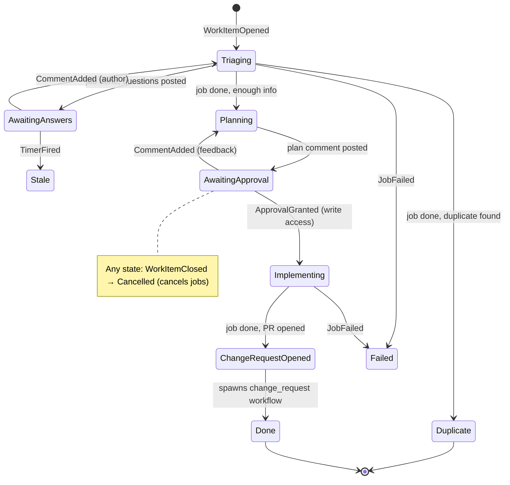
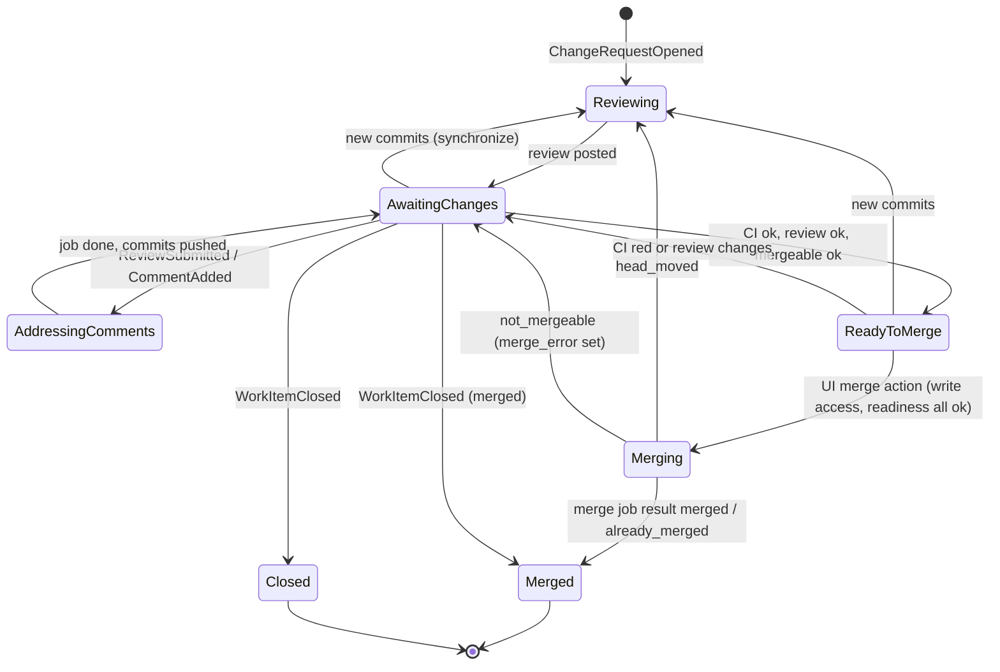

# Workflow engine (`workflows/`)

An in-house, durable workflow engine on Postgres. It doesn't use Kubernetes custom resources, because etcd can't take the throughput, and it doesn't use a third-party engine ([ADR-0008](adr/0008-postgres-workflow-engine.md)).

## Model

Each workflow is an **explicit state machine** with a **pure** transition function:

```rust
fn transition(state: &State, event: &Event) -> (State, Vec<Effect>)
```

- **Everything that advances a workflow is an event:** connector webhooks, UI actions, job results, timers.
- **Effects become jobs:** run an agent step, post a comment, open a PR, set a progress reaction. Jobs run outside the transaction and report their outcome as new events.
- **No replay and no determinism rules.** State is stored explicitly, so a workflow version change only has to read older `state_data` shapes (`workflow_version` column).
- Because transitions are pure, they get table-driven unit tests with no database.

## Tables (schema `workflows`, sqlx migrations)

| Table | Purpose | Key columns |
|---|---|---|
| `events` | Inbox: every input to the engine | `id, source, dedupe_key UNIQUE, work_item_key, type, payload jsonb, received_at, processed_at` |
| `work_items` | One row per issue / PR / mention task | `id, key UNIQUE, project_id, workflow, workflow_version, state, state_data jsonb, wake_at, updated_at` |
| `transitions` | Append-only history; feeds UI checklists and audit | `work_item_id, from_state, to_state, event_id, effects jsonb, at` |
| `jobs` | Effects waiting to run, running, or done | `id, work_item_id, project_id, kind, priority, idempotency_key UNIQUE, status, attempt, max_attempts, run_after, lease_owner, lease_until, input jsonb, output jsonb` |

Key formats:
- `work_items.key` is source-neutral: `github:org/repo#123`, `gitlab:group/proj!45`.
- `events.dedupe_key`: `github:<X-GitHub-Delivery>`, `job:<job_id>:<attempt>`, `timer:<work_item_id>:<wake_at>`, `ui:<uuid>`.
- `jobs.status`: `queued | running | succeeded | failed | cancelled`.

Concurrency caps (agent jobs per project, worktree slots per sandbox) are enforced in the job-claim query by counting `running` jobs. A separate table is added only if that gets too slow.

## Processes

All of them are roles of one `enzarb-workflows` binary and can be scaled separately.

### Ingest (called by connectors and UI)
`workflows_api.ingest_event(...)`: `INSERT … ON CONFLICT (dedupe_key) DO NOTHING`, then `NOTIFY workflow_events`. Receivers never run workflow logic inline.

### Reducer: one transaction per event
```sql
BEGIN;
SELECT … FROM events WHERE processed_at IS NULL ORDER BY id
  FOR UPDATE SKIP LOCKED LIMIT 1;
SELECT … FROM work_items WHERE key = $1 FOR UPDATE;   -- or INSERT if new
-- transition(state, event) in Rust
UPDATE work_items SET state = …, state_data = …, wake_at = …;
INSERT INTO jobs … ON CONFLICT (idempotency_key) DO NOTHING;
INSERT INTO transitions …;
UPDATE events SET processed_at = now();
NOTIFY work_item_changed, '<work_item_id>';
COMMIT;
```
- **Exactly once:** each state change is applied once.
- **Atomic effects:** the jobs it queues commit in the same transaction.
- **Ordered per issue/PR:** the row lock on the work item serializes events for that item.
- **Unrouted events:** an event whose key matches no Project is marked processed with an `ignored` transition, kept for auditing.

### Executors
- **Claiming:** jobs are claimed with `FOR UPDATE SKIP LOCKED`, ordered by `priority DESC, run_after`, and taken with a lease (`lease_owner`, `lease_until`).
- **Short jobs** (connector calls, reactions): run, write `output`, insert a `job:<id>:<attempt>` result event.
- **Agent jobs:**
  1. Resolve the sandbox. In `worktree` mode, use the Project sandbox and create worktree `run-<job_id>`. In `fresh` mode, claim a sandbox from the warm pool.
  2. Over enzarb-proto, send `StartRun { run_id: job.id, repo, ref, prompt, credentials }`. The start is **idempotent**: a repeated `run_id` returns the existing run.
  3. Release the job lease. The job stays `running` with a deadline.
  4. sandbox-init sends `RunFinished { run_id, outcome, summary, transcript_url, usage? }`, which the executor ingests as a result event. `usage` (tokens, models and the cost Claude reported) is added to `jobs.usage` once per `run_id` for every outcome, so a job's total covers all its runs; see contracts section 6.
- **Crash recovery:** when a lease expires, another executor re-sends `StartRun`, which is safe because it is idempotent.
- **Retries:** exponential backoff through `run_after` until `max_attempts`, then a `JobFailed` event.

### Ticker
Turns `work_items.wake_at` and expired job deadlines into `TimerFired` events: nudges, question timeouts, runaway runs.

### Wakeups
LISTEN/NOTIFY gives low latency, and a polling sweep every few seconds acts as the safety net. LISTEN connections must be direct, session-mode connections, never through a transaction-mode pooler.

## Workflows

### `issue`


### `change_request`
Starts for every opened PR/MR, whether the agent opened it or not.


#### Automatic fix rounds and queued feedback
- When enzarb's own review finds must-fix problems (`request_changes`, or `comment` after an unverified `approve` was downgraded), the item goes `Reviewing → AddressingComments` by itself with the review body as the trigger, and the fix is re-reviewed. At most `ENZARB_MAX_AUTO_ROUNDS` (default 3, `0` = off, Helm `workflows.maxAutoRounds`) such rounds run in a row; a human comment or review, or a new head pushed by someone else, resets the count. After the cap the item stays in `AwaitingChanges` with `state_data.waiting_reason = round_limit`. An `approve` goes to `ReadyToMerge` as before.
- A human comment or review that arrives during `Reviewing` or `Merging` is queued like one during `AddressingComments` (`state_data.pending`). When the review posts, or the merge ends in `head_moved` or `not_mergeable`, the queued text starts the next `AddressingComments` round before any automatic one; if the merge succeeds it is dropped.
- `state_data.waiting_reason` (`human_review`, `enzarb_fixing`, `round_limit`) tells the Work page why the item waits.

#### Merging
enzarb never merges its own PRs on its own. A person triggers the merge from the UI.

- **Entering `ReadyToMerge`:** from `AwaitingChanges` once all three readiness checks in `state_data.checklist` (`ci`, `review`, `mergeable`) are `ok`:
  - `ci`: every check run and commit status on the head commit passes, not only branch-protection required checks. A repo with no CI counts as passing. The aggregation rule is in [connectors.md](connectors.md); `CiStatusChanged` events (from `check_suite`, `check_run` and `status` webhooks) trigger a re-evaluation.
  - `review`: enzarb's own review of the current head approves. No human GitHub review is required (see [gaps.md](gaps.md)); the Merge click is the human gate.
  - `mergeable`: the provider reports the PR as mergeable (`get_merge_readiness`).
- **Leaving `ReadyToMerge`:** new commits send it back to `Reviewing`; CI going red or review changes send it back to `AwaitingChanges`; `WorkItemClosed` closes it as usual.
- **Merge action:** `submit_action(..., 'merge')` produces `MergeRequested`, accepted only in `ReadyToMerge`. The reducer rejects it (a `transitions.note`, not a SQL error) if the clicking user lacks write access (`Connector::check_permission` on the actor login) or if readiness is no longer all `ok`. On acceptance the state is `Merging` and a merge job runs `merge_change_request`, pinned to the head SHA it was approved at.
- **Merge job results:**
  - `merged` or `already_merged` → `Merged`;
  - `head_moved` → `Reviewing`;
  - `not_mergeable` → `AwaitingChanges` with `state_data.merge_error` set.
- **New commits during `Merging`** do not cancel the merge. It is pinned to the head, so GitHub refuses it and the job returns `head_moved`.
- **Squash only.** The commit title comes from `squash_title(title, head_ref)` (workflows `machine/title.rs`): the PR title when it is already a Conventional Commit, otherwise a type prefix derived for the PR. See the engine code for the exact derivation.
- **Invariant:** nothing but a UI Merge action merges. No event from a connector, comment or mention, and no timer, can cause `MergeRequested`.

### `mention`
`Mentioned` (`@enzarb …` anywhere) → one `agent_task` job → reply posted → Done. If the mention is on an item that already has a workflow, it goes to that workflow as a comment instead. Exception: an explicit `@enzarb` mention by a user with write access on a `Failed` (or, for issues, `Stale`) `issue` or `change_request` item retries it, exactly like the UI retry. Mentions on finished items (`Done`, `Duplicate`, `Cancelled`) or from users without write access are still ignored, silently.

## Progress feedback
Whenever a transition **accepts** an event, the reducer queues a high-priority `set_progress` job:
- Received → 👀
- Working → 🚀
- Done → 👍
- Failed → 😕

These jobs skip agent concurrency caps, so the acknowledgement lands within seconds. See [connectors.md](connectors.md#progress).

## Authorization of triggers
Before a transition accepts an event, it checks:
- the actor maps to an enzarb identity (`app_api.identity_v`) or has write access (`Connector::check_permission`), as the trigger requires;
- `ApprovalGranted` always needs write access;
- the bot's own comments and reactions are ignored, which prevents loops.

## Out of the engine
Run logs and transcripts never go through these tables. Live output streams from sandbox-init to the UI through the proxy (an enzarb-proto channel). The final transcript goes to object storage, and `jobs.output` keeps only a URL.
