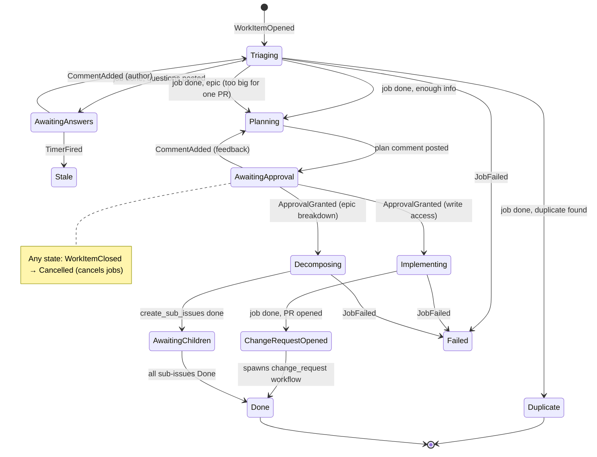
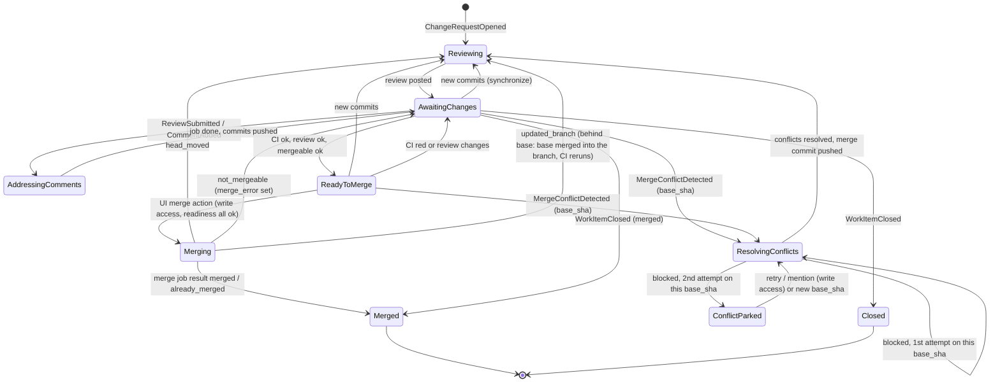

# Workflow engine (`workflows/`)

An in-house, durable workflow engine on Postgres. It doesn't use Kubernetes custom resources, because etcd can't take the throughput, and it doesn't use a third-party engine ([ADR-0008](adr/0008-postgres-workflow-engine.md)).

## Model

Each workflow is an **explicit state machine** with a **pure** transition function:

```rust
fn transition(state: &State, event: &Event) -> (State, Vec<Effect>)
```

- **Everything that advances a workflow is an event:** connector webhooks, UI actions, job results, timers.
- **Effects become jobs:** run an agent step, post a comment, open a PR, set a progress reaction. Jobs run outside the transaction and report their outcome as new events.
- **No replay and no determinism rules.** State is stored explicitly, so a workflow version change only has to read older `state_data` shapes (`workflow_version` column).
- Because transitions are pure, they get table-driven unit tests with no database.

## Tables (schema `workflows`, sqlx migrations)

| Table | Purpose | Key columns |
|---|---|---|
| `events` | Inbox: every input to the engine | `id, source, dedupe_key UNIQUE, work_item_key, type, payload jsonb, received_at, processed_at` |
| `work_items` | One row per issue / PR / mention task | `id, key UNIQUE, project_id, workflow, workflow_version, state, state_data jsonb, wake_at, updated_at` |
| `transitions` | Append-only history; feeds UI checklists and audit | `work_item_id, from_state, to_state, event_id, effects jsonb, at` |
| `jobs` | Effects waiting to run, running, or done | `id, work_item_id, project_id, kind, priority, idempotency_key UNIQUE, status, attempt, max_attempts, run_after, lease_owner, lease_until, input jsonb, output jsonb` |

Key formats:
- `work_items.key` is source-neutral: `github:org/repo#123`, `gitlab:group/proj!45`.
- `events.dedupe_key`: `github:<X-GitHub-Delivery>`, `job:<job_id>:<attempt>`, `timer:<work_item_id>:<wake_at>`, `ui:<uuid>`.
- `jobs.status`: `queued | running | succeeded | failed | cancelled`.

Concurrency caps (agent jobs per project, worktree slots per sandbox) are enforced in the job-claim query by counting `running` jobs. A separate table is added only if that gets too slow.

## Processes

All of them are roles of one `enzarb-workflows` binary and can be scaled separately.

### Ingest (called by connectors and UI)
`workflows_api.ingest_event(...)`: `INSERT … ON CONFLICT (dedupe_key) DO NOTHING`, then `NOTIFY workflow_events`. Receivers never run workflow logic inline.

### Reducer: one transaction per event
```sql
BEGIN;
SELECT … FROM events WHERE processed_at IS NULL ORDER BY id
  FOR UPDATE SKIP LOCKED LIMIT 1;
SELECT … FROM work_items WHERE key = $1 FOR UPDATE;   -- or INSERT if new
-- transition(state, event) in Rust
UPDATE work_items SET state = …, state_data = …, wake_at = …;
INSERT INTO jobs … ON CONFLICT (idempotency_key) DO NOTHING;
INSERT INTO transitions …;
UPDATE events SET processed_at = now();
NOTIFY work_item_changed, '<work_item_id>';
COMMIT;
```
- **Exactly once:** each state change is applied once.
- **Atomic effects:** the jobs it queues commit in the same transaction.
- **Ordered per issue/PR:** the row lock on the work item serializes events for that item.
- **Unrouted events:** an event whose key matches no Project is marked processed with an `ignored` transition, kept for auditing.

### Executors
- **Claiming:** jobs are claimed with `FOR UPDATE SKIP LOCKED`, ordered by `priority DESC, run_after`, and taken with a lease (`lease_owner`, `lease_until`).
- **Short jobs** (connector calls, reactions): run, write `output`, insert a `job:<id>:<attempt>` result event.
- **Agent jobs:**
  1. Resolve the sandbox. In `worktree` mode, use the Project sandbox and create worktree `run-<job_id>`. In `fresh` mode, claim a sandbox from the warm pool.
  2. Over enzarb-proto, send `StartRun { run_id: job.id, repo, ref, prompt, credentials }`. The start is **idempotent**: a repeated `run_id` returns the existing run.
  3. Release the job lease. The job stays `running` with a deadline.
  4. The executor pulls the result: it keeps one mux session per sandbox with accepted runs (`run_subscribe`) and ingests each `run_finished { run_id, outcome, summary, branch, head_sha, pushed, usage?, graph? }`; a results pass every 15 s also asks `run_status` for every accepted run and ingests `run_state.result`, so a dropped session, an executor restart or a sandbox-init restart (results are kept on disk) loses nothing. Sandboxes without `welcome.features` `run_results` still get a `callback_url` and POST the result (deprecated; removed in a follow-up). Every path goes through one idempotent ingestion (stale runs and attempts are dropped; `job:<id>:<attempt>` dedupe) that ingests it as a result event. Push facts are verified against the remote, never taken from the sandbox: `pushed` is true iff the remote branch is at the reported `head_sha` (or, without a usable sha, ahead of `base_ref`), and a recovery run keeps the original run's push facts. `usage` (tokens, models and the cost Claude reported) is added to `jobs.usage` once per `run_id` for every outcome, so a job's total covers all its runs; see contracts section 6.
- **Crash recovery:** when a lease expires, another executor re-sends `StartRun`, which is safe because it is idempotent.
- **Retries:** exponential backoff through `run_after` until `max_attempts`, then a `JobFailed` event.

### Ticker
Turns `work_items.wake_at` and expired job deadlines into `TimerFired` events: nudges, question timeouts, runaway runs.

### Sandbox stats poller
A single-leader loop (Postgres advisory lock) polls each ready sandbox for CPU, memory, storage and I/O counters every `ENZARB_STATS_INTERVAL` (30 s) and writes `workflows.sandbox_stats`. Unreachable or not-ready sandboxes are skipped with per-project backoff, never zero-filled. Rows are pruned after `ENZARB_STATS_RETENTION` days (90). It runs as its own task of the `ticker` role (`engine::sandbox_poller`), so a hung sandbox never delays the ticker. Each sandbox has its own timeout (`ENZARB_STATS_TIMEOUT`, 5 s), at most `ENZARB_STATS_CONCURRENCY` (8) are asked at once, and start times are jittered per project. A sandbox whose `welcome` lacks the `stats` feature, or that answers `unknown_message`, is skipped. Each sample is attributed to the lowest work item with a running `agent_*` job on the Project, or NULL. The leader prunes at most hourly. See [ADR-0019](adr/0019-sandbox-utilization-polling.md).

### Wakeups
LISTEN/NOTIFY gives low latency, and a polling sweep every few seconds acts as the safety net. LISTEN connections must be direct, session-mode connections, never through a transaction-mode pooler.

## Workflows

### `issue`


#### Epics

An issue that is too big for one pull request is broken into sub-issues instead of being implemented (docs/adr/0018-epics.md).

- **Triggers.** Triage answers `epic`; or someone with write access comments `/epic` on its own line, or adds the `epic` label (the connector reports it as `WorkItemLabeled` with `data.label = "epic"`). `/epic` and the label are accepted in `Triaging`, `AwaitingAnswers` and `Stale` (remembered: `IssueData.epic`, the plan is then a breakdown) and in `AwaitingApproval` (the plan is rewritten as a breakdown). From anyone else they do nothing: the label is rejected and `/epic` is an ordinary comment.
- **Breakdown.** Planning an epic uses `plan_epic.md`. The plan body ends its **Sub-issues** list with one fenced block whose info string is `enzarb-subissues`: a JSON array of `{key, title, body, depends_on: [key]}`. The engine validates it (`parse_epic_plan`): at most `Config::max_epic_children` (default 8) entries, unique `[a-z0-9_-]{1,32}` keys, non-empty titles, `depends_on` naming other entries, no cycle. An invalid list fails the plan step (retry from the UI) and nothing is created. The list is stored in creation order (`IssueData.sub_issues`).
- **Approval.** `/approve` (or the UI button) moves the epic to `Decomposing` and queues one `create_sub_issues` job `{item, depth, sub_issues}`. It never starts `Implementing` and the epic never opens a change request.
- **Creation.** For each entry, in order, the connector creates an issue whose body is the plan's text, `Part of the epic #N.`, `Blocked by #X` for each dependency (parsed as text dependencies like any other), and the hidden markers `<!-- enzarb:epic=<epic key>:<key> -->` and `<!-- enzarb:epic-depth=<n> -->`. The idempotency key is `epic-<epic key>-<key>`; the GitHub connector looks for an existing issue carrying it before creating, so a retried job or replayed event makes no duplicates. Then each is linked as a sub-issue (`Connector::link_sub_issue`: GitHub's sub-issues API, else a task list in a managed section of the parent's body), native "blocked by" relationships are added best-effort, and the job records the structure in `work_item_dependencies` with source `epic` (the epic waits for each sub-issue; a sub-issue waits for what it is ordered after). A failure part-way fails the job; **retry** (the `Failed` item's retry action) runs it again and resumes through the markers.
- **Sub-issues are normal issues.** enzarb opens them, so the receiver lets that one bot event through and the engine accepts it only if the marker names a parent that is in the same repository and Project, is `Decomposing` or `AwaitingChildren`, whose approved plan lists that key, and the actor is enzarb's own login. The depth comes from the stored parent (`epic_depth + 1`), not from the body. Each sub-issue is then triaged, planned and approved like any other issue: nothing is implemented without a human `/approve`. `Config::max_epic_depth` (default 1) is the depth at which an issue can no longer be an epic: triage's `epic` becomes `ready` and `/epic` and the label are rejected there.
- **Waiting.** In `AwaitingChildren` the epic is blocked by its sub-issues. The ticker's dependency sweep sends `DependenciesChanged` when the open set changes; the machine stores it (`IssueData.open_dependencies`). When none is left the epic is `Done` with a summary comment. If every remaining sub-issue was closed without completing, the epic comments once and waits; a maintainer can reopen or replace them, or `/approve` to close the epic as it is. Cancelling or closing the epic cancels only the epic: sub-issues stay open. "Done" for a sub-issue is the same as for any issue (its change request was opened), not merged.
- **Closing.** An epic has no change request whose `Closes #N` would close it, so finishing one queues a `close_issue` job `{item, reason}` right after its summary comment (lower priority, so the comment lands first): `completed` when every sub-issue is done, `not_planned` when a maintainer closed it with sub-issues unfinished. The job calls `Connector::close_issue` (GitHub: `PATCH /repos/{o}/{r}/issues/{n}` with `state: closed, state_reason`); closing a closed issue succeeds, so retries are harmless, and its failure is acknowledged and ignored. Only epics queue it: ordinary issues close through their PR. The bot's own `WorkItemClosed` coming back is rejected because the item is already `Done` (a terminal state), as is the job's result.

### `change_request`
Starts for every opened PR/MR, whether the agent opened it or not.


#### Automatic fix rounds and queued feedback
- When enzarb's own review finds must-fix problems (`request_changes`, or `comment` only when an unverified `approve` was downgraded; a plain `comment` waits for a person), the item goes `Reviewing → AddressingComments` by itself with the review body as the trigger, and the fix is re-reviewed. At most `ENZARB_MAX_AUTO_ROUNDS` (default 3, `0` = off, Helm `workflows.maxAutoRounds`) such rounds run in a row; a human comment or review, or a new head pushed by someone else, resets the count. After the cap the item stays in `AwaitingChanges` with `state_data.wait.reason = round_limit`. An `approve` goes to `ReadyToMerge` as before.
- A CI failure on the reviewed head of an `AwaitingChanges` (or `ReadyToMerge`) item starts one `AddressingComments` round per head SHA (`ci_fix_sha`), whose trigger lists the failing checks with their URLs, and whose prompt (`{ci_failure}`) adds each check's conclusion and, for GitHub Actions, the run and job id. The executor gives that run a read-only, single-repository `ci_read_token` (`actions`/`checks`/`metadata: read`, shown to the agent as `GH_TOKEN`), so the agent reads the failed log with `gh run view <run> --log-failed` and reproduces only the failing test. It counts against the same `auto_rounds` cap. A failure during `Reviewing`, `AddressingComments` or `ResolvingConflicts` is recorded and acted on when that run ends. With the cap reached the item waits on a human with `state_data.wait.reason = ci_failed`; Retry resets the count and starts a round. Only GitHub Actions jobs (a run id in the check URL) count toward a round, and only they are listed in its trigger and `{ci_failure}`; when every failing check is outside Actions (a commit status, a third-party app) no round starts and the item waits on a human with `ci_failed_external`. Checks matching `ENZARB_CI_IGNORE_CHECKS` (default `(?i)copilot`, Helm `workflows.ciIgnoreChecks`) never count toward CI at all.
- A human comment or review that arrives during `Reviewing` or `Merging` is queued like one during `AddressingComments` (`state_data.pending`). When the review posts, or the merge ends in `head_moved` or `not_mergeable`, the queued text starts the next `AddressingComments` round before any automatic one; if the merge succeeds it is dropped.
- Why the item waits is only `state_data.wait` (contracts §6): `enzarb_fixing` while an automatic round runs, `round_limit` at the cap, `awaiting_review` when a person has to review.

#### Merging
enzarb never merges its own PRs on its own. A person triggers the merge from the UI.

- **Entering `ReadyToMerge`:** from `AwaitingChanges` once all three readiness checks in `state_data.checklist` (`ci`, `review`, `mergeable`) are `ok`:
  - `ci`: every check run and commit status on the head commit passes, not only branch-protection required checks. A repo with no CI counts as passing. The aggregation rule is in [connectors.md](connectors.md); `CiStatusChanged` events (from `check_suite`, `check_run` and `status` webhooks) trigger a re-evaluation.
  - `review`: enzarb's own review of the current head approves. No human GitHub review is required (see [gaps.md](gaps.md)); the Merge click is the human gate.
  - `mergeable`: the provider reports the PR as mergeable (`get_merge_readiness`).
- **Leaving `ReadyToMerge`:** new commits send it back to `Reviewing`; CI going red or review changes send it back to `AwaitingChanges`; `WorkItemClosed` closes it as usual.
- **Merge action:** `submit_action(..., 'merge')` produces `MergeRequested`, accepted only in `ReadyToMerge`. The reducer rejects it (a `transitions.note`, not a SQL error) if the clicking user lacks write access (`Connector::check_permission` on the actor login) or if readiness is no longer all `ok`. On acceptance the state is `Merging` and a merge job runs `merge_change_request`, pinned to the head SHA it was approved at.
- **Merge job results:**
  - `merged` or `already_merged` → `Merged`;
  - `head_moved` → `Reviewing`;
  - `not_mergeable` → `AwaitingChanges` with `state_data.merge_error` set.
- **Branch deletion:** `merge` may carry `data.delete_branch` (the review dialog's "Delete branch after merge"). It is kept in `state_data.merge_delete_branch` as long as `merge_requested`, and the merge job's input then names the head branch. After `merged` or `already_merged` the job deletes it with `Connector::delete_branch`, best effort, and returns what happened as `output.branch`; the `Merged` transition's note repeats it. The branch is **kept** (with a note) when it is not an `enzarb/...` branch, or when an open change request has `stacked_on` = this one: GitHub would change that child's base by itself without rebasing, which defeats the retarget below. The user can delete the branch later. A delete that fails (protected branch, missing permission) is only a note.
- **Comments from the UI:** `submit_action(..., 'comment')` produces a `CommentAdded` event with source `ui` and `data.body`. On an issue it takes the same path as a GitHub comment (`AwaitingApproval`: plan feedback re-plans, unless it is an `/approve` command; `AwaitingAnswers`: only the author answers) and also queues a `post_comment` job with the text (signed "Sent by @login from enzarb"). The bot's own comment coming back through the webhook is ignored, so one UI comment re-plans once. Change requests and mentions reject it.
- **Behind the base:** when the readiness re-check inside the merge job reports `mergeable_state == "behind"`, it does not merge. It calls `Connector::update_branch` (GitHub `PUT /pulls/{n}/update-branch`: a merge of the base into the branch, never a rebase or force-push) and returns `updated_branch`. The new head is reviewed and CI reruns; the user's click is stored (`state_data.merge_requested`, with `merge_actor`), so once the new head is approved, CI is green and readiness is ok the merge runs without a second click (wait reason `updating_branch` meanwhile). Requested changes, a failed check or a refused merge clear the stored request. A refused update (conflict) is `not_mergeable`.
- **Serialised per repository:** the merge job holds `pg_try_advisory_xact_lock(hashtext('merge:<repo>'))` for the duration of the readiness re-check and merge. If another merge of the same repository holds it, the job is re-queued untouched (a transient error with a short `retry_after`). The lock ends with the transaction, so a crashed worker cannot leave it held. Merges in different repositories do not block each other. A PR left behind by an earlier merge is then updated (above) or sent to conflict resolution before it merges.
- **Conflict resolution:** `MergeConflictDetected {base_sha}` (from the base-head poll or a readiness check that says `mergeable == false`) starts `AgentResolveConflicts`: merge the base into the branch, never rebase or force-push, run the checks, push. At most 2 attempts per `base_sha` (`state_data.resolve_attempts {base_sha, count}`; the older single `resolve_attempted_base_sha` still reads as 1 attempt). After the 2nd blocked attempt the item is `ConflictParked` and appears under Needs you with "Conflict could not be resolved automatically". A new base commit resets the count. `mergeable == null` (GitHub computes it lazily) is neither a conflict nor a final answer: the poll retries it on the next pass.
- **New commits during `Merging`** do not cancel the merge. It is pinned to the head, so GitHub refuses it and the job returns `head_moved`.
- **Squash only.** The commit title comes from `squash_title(title, head_ref)` (workflows `machine/title.rs`): the PR title when it is already a Conventional Commit, otherwise a type prefix derived for the PR. See the engine code for the exact derivation.
- **Invariant:** nothing but a UI Merge action merges. No event from a connector, comment or mention, and no timer, can cause `MergeRequested`. The only merge not started by a click is the resumption of a click already stored in `merge_requested` (see Behind the base).
- **Waiting for the merge lock** re-queues the job after 5s and refunds the attempt (`max_attempts + 1`), so contention never fails a merge.
- **Stacked PRs** (#107, on the dependency model of [ADR-0017](adr/0017-work-item-dependencies.md)):
  - *Choosing the base.* When an issue's implementation starts, the reducer looks at its dependencies (`Ctx::stack_parent`, `dependencies::stack_parent`, the pure `machine::stack::select_stack_parent`). It stacks only when exactly one dependency is not completed, that dependency has an open change request, and the request's branch is enzarb's own (`enzarb/…`). Several open parents, a parent without a change request, and a merged, closed or failed parent stack nothing: the branch starts from the default branch and the `dependencies` merge gate sequences it, as before. The agent run starts from the parent's branch, and the change request opens with the parent's branch as base. Its body ends with a hidden `<!-- enzarb:stack parent=… ref=… tip=… -->` marker; the change request machine records it as additive `state_data` keys (`stacked_on` = the parent change request's key, `stack_parent_ref`, `stack_parent_tip` = the parent head the child was cut from, `default_base`) only when enzarb authored the change request and its base is the marker's branch.
  - *While stacked*, the `dependencies` check is pending ("stacked on …: waits for it to merge"), so the child cannot reach `ReadyToMerge` and nothing can merge it into the parent's branch. If the parent is closed or cancelled the check fails and the child stays blocked under Needs you; nothing is rebased. A parent that moves after the child started is left alone.
  - *Retarget.* When the parent change request reaches `Merged`, `Closed` or `Cancelled`, the reducer sends `DependenciesChanged` to each open child with `stacked_on` = the parent (so it does not wait for the sweep). A child whose parent merged queues one `retarget_change_request` job (`{item, number, head_ref, expected_sha, old_base, onto}`; not an agent job; at most 2 per change request, `retarget_attempts`). The job re-reads the change request under the repository's merge lock (a head that is not `expected_sha` is `lease_failed`), mints a `read_write` credential and starts a sandbox **retarget run** (`RunStart.retarget`, [contracts](contracts.md)): `git rebase --onto origin/<default> <stack_parent_tip>` of the branch and a push with `--force-with-lease=refs/heads/<branch>:<expected_sha>`. When the run reports `retargeted`, the callback calls `Connector::set_base` (an already-correct base is success). Whether the rebase is still needed is decided by git (the remote head and `old_base`), not by the change request's current base: GitHub moves the base by itself when the parent branch is deleted, without rebasing.
  - *Outcomes* (`output.outcome`): `retargeted` → `base_ref` is the default branch, the stack keys are cleared, and the new head is reviewed (`Reviewing`) before the usual checks; `lease_failed` → `Reviewing` with the stack kept (the retarget runs again after the review, up to the cap, then it parks); `conflict`, `foreign_commits` (a commit on the branch not authored by enzarb), `not_ancestor` (the recorded parent tip is not in the branch's history: the tip is stale), `rejected` (not an enzarb branch, or a sandbox that does not know the operation), a failed job and a missed deadline → `ConflictParked` with a comment, stack keys cleared, so the item is under Needs you and the engine does not try again by itself. Nothing is pushed in any of these. A `retargeted` result whose base change the provider refused (`base_set: false`) is parked the same way. Retargeting never merges: the user's Merge click stays the only merge trigger.
  - *Force-push invariant.* The sandbox retarget run is the **only** place in enzarb that rewrites history or pushes with a lease. It force-pushes only to a branch enzarb created (`enzarb/` prefix), never the default or a protected branch, only at an `expected_sha`, only after checking that every commit it replays was authored by enzarb, and never as a general git passthrough. No other component names a force flag (tests scan the engine and the sandbox sources). Everything else, `update_branch` and merge-in conflict resolution included, keeps the rule of never rebasing or force-pushing.
  - *Not covered:* stacking on a parent without a change request, rebasing when the parent changes before it merges, and several parents.

### `mention`
`Mentioned` (`@enzarb …` anywhere) → one `agent_task` job → reply posted → Done. If the mention is on an item that already has a workflow, it goes to that workflow as a comment instead. Exception: an explicit `@enzarb` mention by a user with write access on a `Failed` (or, for issues, `Stale`) `issue` or `change_request` item retries it, exactly like the UI retry. Mentions on finished items (`Done`, `Duplicate`, `Cancelled`) or from users without write access are still ignored, silently.

### Graph workflows
[ADR-0020](adr/0020-graph-workflows.md), first slice. A repository opts in by committing `.enzarb/workflows/issue.yaml` to its default branch; an example is [`workflows/examples/issue.yaml`](workflows/examples/issue.yaml) (prepare, implement, open a change request). Without the file nothing changes: issues run the compiled `issue` machine.

- **Definitions.** The schema, validation (start and edge targets exist, every node can reach an `end`, no unknown types, actions or events, a merge only after a `wait` on exactly `merge_requested`, `after` exactly on waits that list `timer`), the condition language (identifiers over the last node's output, `==`, `!=`, literals, `&&`, `||`, `!`, parentheses) and `advance` (outputs, visit counts, `max_visits` default 5, `on_limit`, `optional`) live in the pure crate `workflows/crates/graph`, shared with sandbox-init. A conditional `next` must end with `else`. A failed `command` or `agent` node (`ok: false`, or a non-zero `exit_code`) fails the graph whatever its edges, unless the node is `optional`; then its edges decide (for example `{"exit_code == 0": open_pr, else: fix}` on an optional check).
- **Start.** For an issue-opening event in a Project with issue triggers, the reducer (before the transaction, like the permission lookup) reads `.enzarb/workflows/issue.yaml` with `Connector::branch_head` and `Connector::get_file` at the default branch head. When it loads and lists `issue_opened` in `on`, the item is created as `graph:issue` with the definition and its sha pinned in `state_data.graph`. A definition that does not validate, or that uses what this kernel cannot run for an issue (the change request actions and waits, see below), falls back to the compiled machine and posts a comment naming the problem. A definition for other triggers falls back silently. Any read error, or no answer within 5 seconds, is logged and falls back too, so a provider outage never holds up events. "No definition at this head sha" is remembered for 5 minutes per repository.
- **Sandbox nodes.** Consecutive `command` and `agent` nodes run as one `agent_segment` job: a sandbox segment run (`RunStart.graph`) on `enzarb/issue-<n>` from the default branch, with push. Named agent prompts (`triage`, `plan`, `implement`, `review`, `address_comments`, `resolve_conflicts`, `task`) are the built-in templates; any other `prompt` string is inline text with the same `{placeholders}`. A `prompt` may also be `{file: .enzarb/prompts/<name>.md}` (name `[A-Za-z0-9_-]+`, checked by validation): the reducer reads every prompt file a definition names with `get_file` at the same head sha, within the same 5-second lookup, and pins their text in `state_data.graph.prompts` with the definition, so a task's prompts never change mid-flight. A missing prompt file makes the definition unusable (compiled machine plus a comment, as for any invalid definition). File prompts are rendered with the same `{placeholders}` as the built-ins; a file prompt counts as an agent that pushes for the dependency guard. The executor renders them with the thread, like other agent jobs. After the walk stops at a kernel node, edits left by `command` nodes are committed and pushed too. An agent node's `pushed` output is true only when HEAD moved during that node and the branch was pushed, so `next: {pushed: ...}` cannot open a change request without new work. The result (`RunFinished.graph`) is untrusted: the kernel accepts it only if `stopped_at` is a kernel node reachable from the segment's start through sandbox nodes (edges and `on_limit`), else the task fails. It takes outputs of sandbox nodes only, never lowers a visit count, keeps its own counts and outputs for kernel nodes, and counts the visit of the stop itself (with `max_visits`/`on_limit`).
- **Kernel nodes.** `post_comment` posts `body`, or the latest agent message's `body`; `open_change_request` opens `enzarb/issue-<n>` against the default branch, titled with the agent's `title` (else the issue title), the latest agent `body` plus `Closes #<n>`, and hands the change request to the `change_request` workflow as the compiled machine does. The node's output is the job's result (`{number, url}` for a change request) and the task continues on it. `wait` sets `Waiting` until a `comment` (from a user with write access; `from: anyone` on the node accepts any human; output `{event, author, body, can_write}`) or an `approval` (write access required, as today; output `{event, author}`) it lists. `end` finishes the task `Done`, `Failed` (with a comment) or `Cancelled`.
- **States.** `Running` (a job is in flight; `state_data.waiting_on` names its kind), `Waiting`, `Done`, `Failed`, `Cancelled`. Closing the issue or a write-access cancel cancels. A retry (UI retry, or an @mention by a user with write access) of a `Failed` task restarts it at `start` with the definition re-read from the default branch, or the pinned one when that lookup fails; the note says `retry; restarted at <node>`.
- **Adopting compiled `issue` items.** When the default branch has a usable issue graph (same lookup, timeout, cache and fallback as on open), an open compiled `issue` item moves to `graph:issue` (`work_items.workflow` changes, `workflow_version` stays 1) when a human acts on it:
  - an accepted approval of its plan in `AwaitingApproval` (`/approve`, the label or the UI, write access as before) places it at the definition's first `wait` on `approval` (breadth-first from `start`) and resumes it with `{event: "approval", author}` in the same transaction, so the next segment is queued at once; the compiled plan becomes `{plan}` for the graph's prompts. A definition with no such wait keeps the item on the compiled machine;
  - an accepted retry of a `Failed` or `Stale` item (UI retry, or a write-access @mention; the author answering a `Stale` issue is still an answer) starts the graph fresh at `start`.
  
  The note is `plan approved; moved to graph workflow at <node>` or `retry; moved to graph workflow at <node>`. Plan feedback, epics, items with a queued or running agent job, other states, rejected events and any lookup failure or invalid definition stay on the compiled machine, unchanged.
- **Epics as graph nodes** ([ADR-0018](adr/0018-epics.md); example [`workflows/examples/epic-issue.yaml`](workflows/examples/epic-issue.yaml)).
  - *Item facts.* Conditions that name something the last node's output lacks read the item facts the kernel keeps (reserved output `_item`; node ids cannot start with `_`): `epic`, `epic_allowed` and `epic_depth`. `epic` is set by a triage `epic` decision, or `/epic` on its own line or the `epic` label from a user with write access (a `/epic` comment also counts as a comment at a wait, so `{epic: plan_epic, else: plan}` re-plans it as a breakdown). At `Config::max_epic_depth` `epic_allowed` and `epic` are false and the label is rejected. `plan_epic` is a named prompt (the breakdown plan); the body of the latest `plan` decision is stored as the plan.
  - *`create_sub_issues` action.* Parses the stored plan with `parse_epic_plan` (`max_epic_children`); an unusable breakdown fails the node. Then the same `create_sub_issues` job as the compiled machine (depth `epic_depth + 1`, markers, links, `work_item_dependencies` source `epic`); output `{created: [{key, number}]}`. Validation requires every edge into it to come from a `wait` that lists `approval` (not through `on_limit`), so nothing creates issues without a human approve.
  - *`children_done` / `dependencies_done` waits.* The ticker's dependency sweep covers graph tasks at a `wait` (and `Blocked` ones). The task stores each `DependenciesChanged` and resumes once none of its sub-issues (`children_done`) or dependencies (`dependencies_done`) is still pending, with `{event, open, completed, failed}` (work item keys; `failed` = closed without completing), so a definition can branch: all done → done, something failed → tell people and wait for a human. Reaching an `end` with status `done` after creating sub-issues (`state_data.children` non-empty) queues the same `close_issue` job with reason `completed`.
  - *Sub-issue intake.* A bot-opened issue with an epic marker is accepted for a graph parent too, when that parent is at `create_sub_issues` or a children wait (`state_data.accepts_children`) and lists the key in its stored `sub_issues`; the depth comes from the stored parent. Sub-issues then start by their repository's definition like any issue. Compiled epics stay on the compiled machine (they are never adopted).
- **Dependency guard (`Blocked`).** Enforced by the kernel, not by definitions. A dependency is *completed* when its change request is merged, or (without one) it finished `Done`; an open change request is not completed. A graph task with a dependency (text, native or epic sibling) that is not completed does not enter `start`: it is `Blocked`, with `state_data.wait` `{waiting_on: "dependency", reason: "dependencies_open", text: "Blocked by #3 (title, state, PR … not merged), …"}`. A dependency that cannot complete by itself (its change request closed, or it was cancelled, closed, a duplicate or failed) makes it `{waiting_on: "human", reason: "dependency_failed"}`, shown under Needs you. When the dependency sweep sees every dependency completed, the task enters `start` by itself. Dependencies added later do not interrupt planning or waits, but the same guard runs before every segment that can reach an `agent` that pushes (any prompt but `triage`, `plan`, `plan_epic`, `review`): the task is `Blocked` and resumes at that node. Closing or cancelling still works while blocked; a write-access retry re-evaluates (no override). A dependency closed on GitHub as completed without a change request counts as failed (enzarb cannot tell it from not planned).
- **Why it waits.** Every `wait` node sets `state_data.wait` `{waiting_on, reason, text}` (contracts §6): the node's optional `reason` and `text` (`reason` matches `[a-z_]{1,64}`), or one derived from its events (`merge_requested` → `ready_to_merge`, `approval` on an issue → `approval`, `comment`/`review` → `awaiting_review` on a change request (`checks_unverified` when enzarb's review could not verify its checks) and `question` on an issue, `ci` → `ci_pending`, `children_done`/`dependencies_done` → `children_open`). `waiting_on` follows the reason (`ready_to_merge`, `approval`, `question`, `awaiting_review`, `checks_unverified`, `round_limit`, `ci_failed`, `conflict_parked`, ... are `human`; `ci_pending` is `ci`). A running job sets an `enzarb` wait (`reviewing`, `enzarb_fixing`, `addressing_comments`, `resolving_conflict`, `updating_branch`, `working`; `merging` is `github`). The UI's Needs you and board classify a `Waiting` graph task waiting on `human` like a compiled item: `approval` (approve button), `ready_to_merge` (merge button), `awaiting_review`/`checks_unverified` (review), `question`, anything else blocked.
- **Timers.** A wait that lists `timer` must set `after` (`30s`, `30m`, `2h`, `1d`: one unit); entering it sets `wake_at`, leaving it clears it, and the ticker's `TimerFired` resumes it with `{event: "timer"}`.

#### Change requests as graphs
A repository opts in with `.enzarb/workflows/change_request.yaml` on its default branch (`on: [change_request_opened]`); [`workflows/examples/change_request.yaml`](workflows/examples/change_request.yaml) mirrors the compiled machine. Every change request that opens there (including the one an issue graph's or the compiled issue machine's `open_change_request` hands off) is created as `graph:change_request`, with the same lookup, 5-second timeout, fallback, cache, pinning and prompt files as issues. A **stacked** change request (the stack marker, see Stacked PRs) stays on the compiled machine: retargeting and force-pushing are compiled-only. A definition that names issue-only actions (`open_change_request`, `create_sub_issues`) or waits (`children_done`) is rejected with a comment, and an issue definition naming change request actions or waits likewise.

- **Facts.** `state_data.cr.data` holds the compiled machine's change request data (head, base, review, CI, mergeability, merge request, automatic rounds, failing checks); the UI checklist is derived from it as for a compiled item. Conditions read them as item facts: `review` (enzarb's verdict `approve`, `request_changes` or `comment` on the current head, else empty), `must_fix` (1 for `request_changes`; for an approve downgraded to `comment` the number of unverified checks; else 0), `auto_rounds`, `ci` (`success`, `failure`, `pending`, `unknown` on the head), `ci_fix_due` (CI failed on the reviewed head and no fix round ran for it), `mergeable`, `head_sha`, `stacked`, `dependencies_open`.
- **Runs.** Segments run on the change request's own branch (`base_ref` = `branch` = its head branch), pushing only when they can reach an agent that pushes (`review` does not). Named prompts get the compiled context (`{trigger}`, `{ci_failure}`, `{head_sha}`, ...). Before a segment that starts at an `address_comments` agent, the kernel writes its trigger: a person's comment or review text (`human_acted`: the round count resets), enzarb's must-fix review body (an automatic round, counted), or, when `ci_fix_due`, the failing checks (an automatic CI-fix round: `ci_fix_sha`, counted, and the run gets the read-only `ci_read_token`). A segment's final head becomes the change request's head and the head its review saw.
- **Actions.** `post_review` posts the latest agent message as `### enzarb review: <decision>` with the compiled rules (an approve without verified checks is downgraded to `comment`), records the verdict at the head the review saw, and continues once the comment is posted with `{decision, must_fix, body}`. `check_merge_readiness` asks the connector and continues with `{head_sha, ci, mergeable, mergeable_state, base_sha, current}` (it also emits `MergeConflictDetected` like the compiled check). `update_branch` merges the base into the branch (`{outcome: updated | refused, reason?}`). `merge_change_request` runs the compiled merge job (pinned to the head, squash title from `squash_title`, branch deletion rules, the repository merge lock, the readiness re-check, `behind` → `updated_branch`) and continues with `{outcome, actor, ...}`; `merged`/`already_merged` end the task `Merged` (with the "merged by" comment) whatever the edges say, `head_moved` and `not_mergeable` clear the merge request, `updated_branch` keeps it.
- **Waits.** `ci` resumes when CI on the head becomes `success` or `failure` (a passing check asks for the aggregate first), or when mergeability becomes known while green, once per head and result: `{event, status, failing: [{name, url, run_id, job_id}], head_sha, mergeable}`; the ticker re-polls a task whose wait is on `ci`. `review` takes a human GitHub review (`{event, author, state, body, can_write}`; `approved` from a writer also records an approval, a dismissed or empty `commented` review is ignored). `pushed` takes a new head the running job did not push (`{event, head_sha, author}`); a person's push resets the round count and clears a merge request. `merge_requested` takes the UI merge from a writer with no open dependency (`{event, author, delete_branch}`); the readiness re-check stays in the merge job. The click is stored like the compiled `merge_requested`, so a later wait on `merge_requested` (the gate before the merge, or the merge wait after `updated_branch` and a new review) resumes at once without a second click, until a person's push, a CI failure, feedback or a refused merge clears it. The click is pinned to the head it was given for: it moves only to the base-update commit of the merge job's `updated_branch` (or an `update_branch` action); any other new head (enzarb's own fixes and conflict merges included), a review that does not approve, a red readiness check or a dependency left open at the replay or the merge action drops it, and a person clicks again. A segment's head becomes the change request's head only when the segment pushed and nobody moved the head during the run; its review counts for the head the segment started at. `conflict` takes `MergeConflictDetected {base_sha}` for a change request enzarb opened, once per base commit (the base-head poll covers `graph:change_request` tasks at a wait): `{event, base_sha}`. `comment` and `approval` work as for issues; `/approve` and the UI approve set enzarb's review check to passed for the head. Closing the change request ends the task `Merged` or `Closed` (jobs cancelled); reopening a `Closed` one restarts at `start`.
- **Nothing is lost while a job runs.** Feedback from a writer during a run is queued (👀) and resumes the next wait on `comment`/`review` first; a person's push, a stored merge click, a conflict and a CI result not acted on yet resume the next wait that lists them, in that order.
- **Merge invariant.** Validation still allows `merge_change_request` only after a wait on exactly `merge_requested`, and the kernel refuses the merge action without a stored human click. Nothing else merges.
- **Differences from the compiled machine.** The automatic-round cap is the definition's `max_visits` on its fix node (3 in the example, then `on_limit` to a `round_limit` wait), counted per task rather than per streak since a person last acted; dependencies gate the merge click, not the runs (no `Blocked` for change requests); stacked change requests are not supported. A graph task's detail page shows the checklist only through the generic fields.
- **Rollout.** The example uses events (`pushed`, `conflict`) and actions that an older `enzarb-graph` does not know, so sandbox-init must be updated before a repository commits a change request definition (an older sandbox rejects the definition and the segment fails).
- **Not in this slice:** built-in default graphs, retiring the compiled machines, stacked change requests as graphs, and a UI detail page for graph change requests beyond Needs you, the board and the generic fields.

## Progress feedback
Whenever a transition **accepts** an event, the reducer queues a high-priority `set_progress` job:
- Received → 👀
- Working → 🚀
- Done → 👍
- Failed → 😕

These jobs skip agent concurrency caps, so the acknowledgement lands within seconds. See [connectors.md](connectors.md#progress).

## Authorization of triggers
Before a transition accepts an event, it checks:
- the actor maps to an enzarb identity (`app_api.identity_v`) or has write access (`Connector::check_permission`), as the trigger requires;
- `ApprovalGranted` always needs write access;
- the bot's own comments and reactions are ignored, which prevents loops.

## Out of the engine
Run logs and transcripts never go through these tables. Live output streams from sandbox-init to the UI through the proxy (an enzarb-proto channel). The final transcript goes to object storage, and `jobs.output` keeps only a URL.
